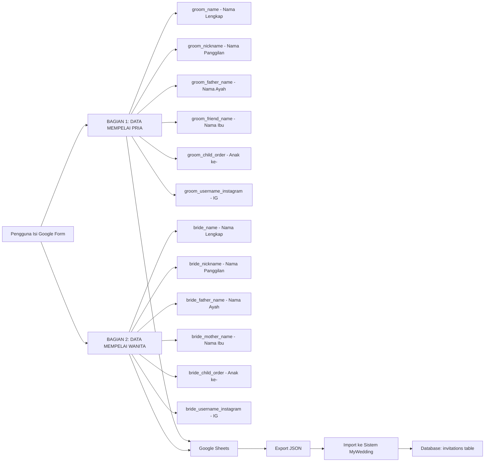

# Prompt: Buat Google Form untuk Input Data Pengantin

Berikut adalah prompt yang dapat Anda salin dan beri ke AI Assistant (ChatGPT, Claude, Gemini, dll) untuk membuat Google Form input data pengantin sesuai format aplikasi MyWedding Invitation.

---

## Prompt

> **[ROLE]** Kamu adalah asisten AI yang ahli dalam membuat Google Form.
>
> **TUGAS:** Buatkan saya Google Form untuk mengumpulkan data pengantin (mempelai pria dan mempelai wanita) untuk sebuah undangan pernikahan digital. Form ini akan diintegrasikan dengan sistem undangan pernikahan berbasis web.
>
> **INSTRUKSI:**
>
> 1. **Judul Form:** "Data Pengantin - Undangan Pernikahan"
> 2. **Deskripsi Form:** "Lengkapi data mempelai pria dan mempelai wanita sesuai dengan format yang diminta. Pastikan semua data diisi dengan benar."
>
> **BAGIAN 1: DATA MEMPELAI PRIA (Groom)**
>
> Buat field-field berikut:
>
> | No | Nama Field (Judul Pertanyaan) | Tipe Field | Wajib? | Pilihan/Opsi | Catatan |
> |----|------------------------------|------------|--------|--------------|---------|
> | 1 | Nama Lengkap Mempelai Pria | Short answer | Ya | - | Nama sesuai KTP. Key: `groom_name` |
> | 2 | Nama Panggilan Mempelai Pria | Short answer | Ya | - | Nama panggilan. Key: `groom_nickname` |
> | 3 | Nama Ayah Mempelai Pria | Short answer | Ya | - | Key: `groom_father_name` |
> | 4 | Nama Ibu Mempelai Pria | Short answer | Ya | - | Key: `groom_mother_name` |
> | 5 | Anak ke- (Mempelai Pria) | Dropdown | Ya | Anak pertama, Anak ke-2, Anak ke-3, Anak ke-4, Anak ke-5, Anak ke-6, Anak ke-7, Anak ke-8, Anak ke-9, Anak ke-10 | Key: `groom_child_order` (format: "Anak ke-X" atau "Anak pertama") |
> | 6 | Username Instagram Mempelai Pria | Short answer | Tidak | - | Tanpa tanda @. Key: `groom_username_instagram` |
>
> **BAGIAN 2: DATA MEMPELAI WANITA (Bride)**
>
> Buat field-field berikut:
>
> | No | Nama Field (Judul Pertanyaan) | Tipe Field | Wajib? | Pilihan/Opsi | Catatan |
> |----|------------------------------|------------|--------|--------------|---------|
> | 7 | Nama Lengkap Mempelai Wanita | Short answer | Ya | - | Nama sesuai KTP. Key: `bride_name` |
> | 8 | Nama Panggilan Mempelai Wanita | Short answer | Ya | - | Nama panggilan. Key: `bride_nickname` |
> | 9 | Nama Ayah Mempelai Wanita | Short answer | Ya | - | Key: `bride_father_name` |
> | 10 | Nama Ibu Mempelai Wanita | Short answer | Ya | - | Key: `bride_mother_name` |
> | 11 | Anak ke- (Mempelai Wanita) | Dropdown | Ya | Anak pertama, Anak ke-2, Anak ke-3, Anak ke-4, Anak ke-5, Anak ke-6, Anak ke-7, Anak ke-8, Anak ke-9, Anak ke-10 | Key: `bride_child_order` (format: "Anak ke-X" atau "Anak pertama") |
> | 12 | Username Instagram Mempelai Wanita | Short answer | Tidak | - | Tanpa tanda @. Key: `bride_username_instagram` |
>
> **PENGATURAN TAMBAHAN:**
>
> - Aktifkan **"Menerima respons"** (bisa dikumpulkan lewat Google Sheets)
> - Atur agar **setiap pengguna hanya bisa mengirimkan sekali** (jika memungkinkan)
> - Aktifkan notifikasi email ke pemilik form ketika ada respons baru
> - Gunakan tema warna emas/merah muda yang cocok untuk pernikahan
> - Tambahkan logo undangan jika tersedia
>
> **FORMAT NAMA FIELD (untuk integrasi sistem):**
>
> Setelah membuat form, beri tahu saya **nama persis dari setiap field** yang harus saya gunakan sebagai key saat membaca respons dari Google Sheets. Nama field harus sesuai dengan key di sistem:
>
> - `groom_name`
> - `groom_nickname`
> - `groom_father_name`
> - `groom_mother_name`
> - `groom_child_order`
> - `groom_username_instagram`
> - `bride_name`
> - `bride_nickname`
> - `bride_father_name`
> - `bride_mother_name`
> - `bride_child_order`
> - `bride_username_instagram`
>
> **FORMAT KUNCI JAWABAN:**
> Setelah form selesai, beri saya langkah-langkah untuk:
> 1. Membuka Google Sheets yang terhubung dengan form
> 2. Memastikan header kolom di Google Sheets sesuai dengan nama field di atas
> 3. Menyiapkan cara integrasi agar data dapat diexport ke JSON dengan field names sesuai key di atas
>
> Tolong berikan konfirmasi bahwa semua field telah terbuat dengan nama yang tepat dan siap pakai untuk integrasi sistem.

---

## Visual: Struktur Google Form

```
📋 Google Form: "Data Pengantin - Undangan Pernikahan"
========================================================

📌 BAGIAN 1: DATA MEMPELAI PRIA
  ├─ [Short Answer]  Nama Lengkap Mempelai Pria       (key: groom_name)        [Wajib]
  ├─ [Short Answer]  Nama Panggilan Mempelai Pria      (key: groom_nickname)    [Wajib]
  ├─ [Short Answer]  Nama Ayah Mempelai Pria           (key: groom_father_name) [Wajib]
  ├─ [Short Answer]  Nama Ibu Mempelai Pria            (key: groom_mother_name) [Wajib]
  ├─ [Dropdown]      Anak ke- (Mempelai Pria)          (key: groom_child_order) [Wajib]
  │    ▼ Options: Anak pertama | Anak ke-2 | Anak ke-3 | Anak ke-4 | Anak ke-5
  │              | Anak ke-6 | Anak ke-7 | Anak ke-8 | Anak ke-9 | Anak ke-10
  └─ [Short Answer]  Username Instagram Mempelai Pria  (key: groom_username_instagram) [Opsional]

📌 BAGIAN 2: DATA MEMPELAI WANITA
  ├─ [Short Answer]  Nama Lengkap Mempelai Wanita      (key: bride_name)         [Wajib]
  ├─ [Short Answer]  Nama Panggilan Mempelai Wanita    (key: bride_nickname)     [Wajib]
  ├─ [Short Answer]  Nama Ayah Mempelai Wanita         (key: bride_father_name)  [Wajib]
  ├─ [Short Answer]  Nama Ibu Mempelai Wanita          (key: bride_mother_name)  [Wajib]
  ├─ [Dropdown]      Anak ke- (Mempelai Wanita)        (key: bride_child_order)  [Wajib]
  │    ▼ Options: Anak pertama | Anak ke-2 | Anak ke-3 | Anak ke-4 | Anak ke-5
  │              | Anak ke-6 | Anak ke-7 | Anak ke-8 | Anak ke-9 | Anak ke-10
  └─ [Short Answer]  Username Instagram Mempelai Wanita (key: bride_username_instagram) [Opsional]

✅ Submit → Google Sheets (kolom header = key names di atas)
```

## Visual: Google Sheets Headers (output)

```
+----+---------------------+---------------------+-------------------+-------------------+-----------------+--------------------------+----+---------------------+---------------------+-------------------+-------------------+-----------------+--------------------------+
| No | groom_name          | groom_nickname      | groom_father_name | groom_mother_name | groom_child_order | groom_username_instagram |    | bride_name          | bride_nickname      | bride_father_name | bride_mother_name | bride_child_order | bride_username_instagram |
+----+---------------------+---------------------+-------------------+-------------------+-----------------+--------------------------+----+---------------------+---------------------+-------------------+-------------------+-----------------+--------------------------+
|  1 | Ahmad Fauzan        | Fauzan              | Bapak Hadi         | Ibu Siti          | Anak ke-2        | fauzan_akbar            |    | Siti Rahayu         | Rahayu            | Bapak Wijaya      | Ibu Dewi         | Anak pertama      | siti_rahayu            |
+----+---------------------+---------------------+-------------------+-------------------+-----------------+--------------------------+----+---------------------+---------------------+-------------------+-------------------+-----------------+--------------------------+
```

## Visual: Flow Diagram (Mermaid)



## Cara Menggunakan

1. Salin seluruh prompt di atas (bagian yang berada di antara dua garis horizontal tipis).
2. Buka [Google Forms](https://forms.google.com), [ChatGPT](https://chat.openai.com), [Claude](https://claude.ai), atau [Gemini](https://gemini.google.com).
3. Tempelkan prompt ke AI Assistant dan minta ia membuatkan Google Form atau AI yang dapat mengakses Google Forms secara langsung.
4. Ikuti instruksi AI untuk menyelesaikan form.
5. Pastikan field names di Google Sheets sesuai dengan key di atas untuk integrasi dengan sistem MyWedding.

## Ringkasan Field yang Dibutuhkan

| Key | Label | Tipe | Wajib |
|-----|-------|------|-------|
| `groom_name` | Nama Lengkap Mempelai Pria | Short answer | Ya |
| `groom_nickname` | Nama Panggilan Mempelai Pria | Short answer | Ya |
| `groom_father_name` | Nama Ayah Mempelai Pria | Short answer | Ya |
| `groom_mother_name` | Nama Ibu Mempelai Pria | Short answer | Ya |
| `groom_child_order` | Anak ke- (Mempelai Pria) | Dropdown | Ya |
| `groom_username_instagram` | Username Instagram Mempelai Pria | Short answer | Tidak |
| `bride_name` | Nama Lengkap Mempelai Wanita | Short answer | Ya |
| `bride_nickname` | Nama Panggilan Mempelai Wanita | Short answer | Ya |
| `bride_father_name` | Nama Ayah Mempelai Wanita | Short answer | Ya |
| `bride_mother_name` | Nama Ibu Mempelai Wanita | Short answer | Ya |
| `bride_child_order` | Anak ke- (Mempelai Wanita) | Dropdown | Ya |
| `bride_username_instagram` | Username Instagram Mempelai Wanita | Short answer | Tidak |
